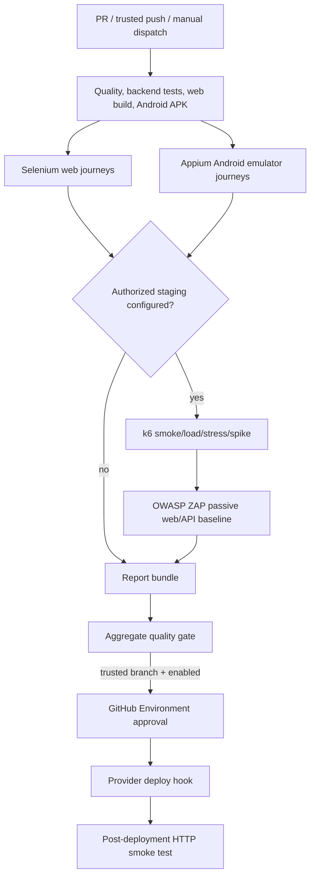

# CareerVue Product Design Document

## Automated Testing and CI/CD Pipeline

### 1. Overview and objectives

The pipeline protects the existing CareerVue monorepo without changing its
architecture: Next.js 16 web, Expo SDK 57/React Native mobile, FastAPI, and
PostgreSQL/Supabase. It provides reproducible quality checks, browser and device
journeys, non-destructive performance/security checks, web/mobile builds,
central reporting, and a guarded path to web deployment.

Known operational constraints are represented as gates rather than concealed:
there is no configured web hosting provider/hostname, no staging Fly API because
billing was previously blocked, and the Expo application is not linked to an
EAS project. Consequently deployment is disabled by default and mobile CI
creates a debug APK for Appium, not a signed store artifact.

### 2. CI/CD architecture

Pull requests cannot access external staging tests or deployment. `staging` and
`production` GitHub Environments supply approvals and scoped secrets.

### 3. Workflow structure

| Workflow | Responsibility |
|---|---|
| `ci.yml` | Triggers, dependencies, aggregate quality gate, deployment routing |
| `build.yml` | npm lint/type checks, backend regression/PostgreSQL tests, Next.js build, Expo validation, Android APK |
| `web-tests.yml` | Headless Selenium execution and reports |
| `mobile-tests.yml` | Appium 2 + UiAutomator2 on an Android API 35 emulator |
| `performance-tests.yml` | Pinned k6 container and selectable profiles |
| `security-tests.yml` | Pinned ZAP passive baselines and severity gate |
| `report.yml` | Always-run collection, HTML/JSON summary, ZIP bundle |
| `deploy.yml` | Environment-scoped provider hook and smoke test |

Existing `frontend-release.yml` and `quiz-postgres-integration.yml` remain as
focused compatibility/regression checks; branch protection may migrate to the
new aggregate gate after it proves stable.

### 4. Selenium web testing strategy

Pytest/Selenium uses explicit `WebDriverWait` conditions and supports Chrome or
Firefox through `E2E_BROWSER`. The required local suite checks the actual
CareerVue landing page, registration role/details flow, client form validation,
password recovery navigation, and anonymous protected-route redirect. Optional
staging credentials unlock real student authentication/course navigation and a
tutor draft-course creation journey. When staging E2E is enabled, missing
credentials fail rather than silently skip.

The pytest fixture captures a PNG for every failed test. Pytest emits JUnit XML
and a self-contained HTML report.

### 5. Appium mobile testing strategy

The Expo configuration is prebuilt into a native Android project and Gradle
produces `app-debug.apk`. Appium 2.19 with UiAutomator2 drives an API 35 emulator
and validates application launch, invalid authentication feedback, student/tutor
role navigation, registration validation, and verified-student authentication
when staging E2E is enabled, using visible application semantics. Failure
screenshots, logcat, the Appium server log, JUnit XML, and a
self-contained HTML report are retained.

The debug build is appropriate for deterministic emulator testing. A signed
internal/production EAS build requires the missing EAS project linkage and an
`EXPO_TOKEN`; signing material must remain in EAS/GitHub Secrets, never Git.

### 6. k6 performance strategy

`tests/performance/careervue.js` exercises the real non-mutating `/health` and
public `/api/v1/courses/` endpoints. Profiles are smoke, ramped load, stress,
and spike. Durations/VUs are environment-configurable. Default normal gates are
HTTP failures below 1%, P95 below 500 ms, and zero unexpected 5xx responses.
The report records average/P90/P95, request count and throughput, failure rate,
checks, and threshold results in JSON, HTML, and raw k6 JSON.

The known production API is rejected. Stress/spike execution requires manual
dispatch against an explicitly authorized staging target.

### 7. OWASP ZAP DAST strategy

Routine CI uses ZAP passive baseline scans against the staging web origin and
the staging API OpenAPI document. It surfaces security headers, configuration,
injection/XSS indicators, and authentication-related passive findings. HTML and
JSON reports are produced for both targets and `severity-summary.json` combines
counts. `ZAP_FAIL_ON` controls whether high, medium, or no findings fail the
gate; high is the default.

Active/full scanning is excluded because it can mutate data. It may only be
introduced as a separately approved manual workflow for an isolated environment
with disposable data and credentials redacted from reports.

### 8. Web and mobile build process

`npm ci` consumes the committed lockfile. The quality job runs web ESLint,
mobile/shared TypeScript checks, Alembic head validation, all backend unit and
disposable-PostgreSQL integration tests, `pip check`, and Python compilation.
The web job runs the existing Next.js production build and verifies `.next/BUILD_ID`.
The mobile job runs Expo Doctor, an Android JS export, clean Expo prebuild, and
Gradle `assembleDebug`; the APK is uploaded for Appium and download.

### 9. Report generation and bundling

Each job writes a small stage status JSON and uploads reports with `if: always()`.
`scripts/ci/bundle_reports.py` downloads/copies the stage artifacts, fills in
explicit `skipped` entries, extracts k6/security summaries, writes
`summary/pipeline-summary.html` and `.json`, and creates `ci-reports.zip`.
GitHub's job summary shows the stage matrix and headline metrics.

### 10. Deployment architecture

No web provider exists in repository configuration, so deployment is disabled.
Once an existing provider is selected, store its protected deploy hook in each
GitHub Environment as `WEB_DEPLOY_HOOK_URL`, set the expected environment URL,
document provider rollback, and enable `WEB_DEPLOY_ENABLED`. Only trusted branch
pushes that pass the aggregate gate can call the reusable deployment workflow.
The workflow waits for an HTTP 2xx response from the deployed URL and reports it.

The current Fly/Railway files deploy the backend only and are not repurposed for
the web app. The production Fly API is never a test target.

### 11. Quality gates and acceptance criteria

| Stage | Gate |
|---|---|
| Code quality | npm lint and all TypeScript checks pass |
| Backend/unit | Alembic and full unittest suite pass against disposable PostgreSQL |
| Selenium | All required public tests pass; staging auth tests pass when enabled |
| Appium | APK builds, installs, launches, and all emulator journeys pass |
| Performance | configured k6 thresholds pass |
| DAST | no finding at/above configured severity |
| Web build | Next.js build and output verification pass |
| Mobile build | Expo validation/export, prebuild, Gradle APK pass |
| Reports | consolidated bundle uploads even after prior failures |
| Deployment | provider call and post-deployment HTTP probe pass |

Skipped staging tests are visible and acceptable only when the associated
environment is not configured. A started optional stage cannot fail silently.

### 12. Environment variables and secrets

Public CI build variables are dummy non-secret URLs/keys. Runtime configuration
uses `STAGING_WEB_URL`, `STAGING_API_URL`, `PRODUCTION_WEB_URL`,
`RUN_STAGING_E2E`, `RUN_STAGING_SCANS`, `WEB_DEPLOY_ENABLED`, `K6_P95_MS`,
`K6_FAILURE_RATE`, and `ZAP_FAIL_ON`. Staging E2E secrets are the student/tutor
email/password pairs. `WEB_DEPLOY_HOOK_URL` is environment-scoped. A future
signed EAS job uses `EXPO_TOKEN`. Backend database, Supabase service-role, JWT,
SMTP, and payment secrets are never passed to browser/mobile tests or reports.

### 13. Workflow execution

- Pull request: mandatory quality, builds, local Selenium, and Appium.
- Trusted development push: same, plus configured staging scans and optional
  staging deployment.
- Main push: complete configured release gate and optional production deployment.
- Manual: choose a k6 profile or run ZAP against authorized staging URLs.

Local commands and configuration tables are maintained in the repository root
`README.md`.

### 14. Failure handling and troubleshooting

Download the failing stage artifact first, then the consolidated ZIP. Selenium
and Appium screenshots identify the last UI state; Appium/logcat and web server
logs identify startup/runtime failures. k6 threshold output names the violated
metric. ZAP severity JSON lists source report, alert, risk, and count. Android
emulator failures should be retried only after inspecting boot/Appium logs.
Missing staging URLs deliberately skip external stages; enabling staging E2E
without its credentials deliberately fails.

### 15. Limitations and future improvements

- Link the Expo slug to an approved EAS project and add signed APK/AAB builds.
- Select/configure the real web provider, immutable release identification, and
  tested rollback before enabling deployment.
- Provision the named staging API/web deployments recorded as absent in the
  existing release runbook.
- Add isolated fixture provisioning/cleanup to expand authenticated CRUD across
  admin approvals, enrollment, course completion, and quiz workflows.
- Add a separately authorized active ZAP workflow for disposable environments.
- Remediate the three critical production-tree advisories recorded in
  `DEPENDENCY_AUDIT.md`, then add a required SCA gate before enabling deployment.
- Pin GitHub-maintained actions to reviewed commit SHAs through an automated
  dependency update policy after the first successful hosted run.

